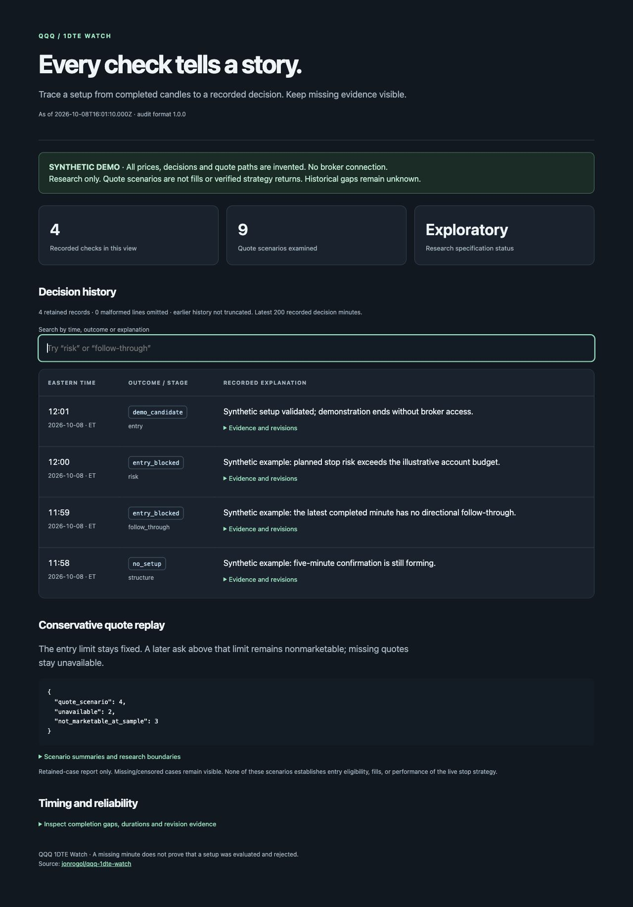
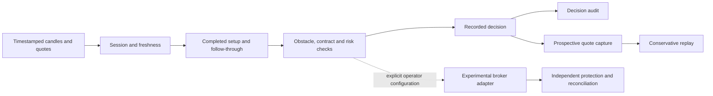

# QQQ 1DTE Watch

[](https://github.com/jonrogol/qqq-1dte-watch/actions/workflows/ci.yml)
[](LICENSE)
[](package.json)

**An auditable research toolkit for QQQ intraday setups and short-dated options.**

Follow a setup from completed five-minute candles through one-minute confirmation, explain why a check stopped, and replay the quotes that were actually available. Missing evidence stays visible.

[Quickstart](#quickstart) · [Architecture](docs/architecture.md) · [Research methodology](docs/research.md) · [Broker integration](docs/broker-integration.md) · [Contributing](CONTRIBUTING.md)



*The preview is synthetic. It shows the reporting interface, not historical trades or performance.*

## Quickstart

Requires Node.js 20.20+ and npm. The demo runs locally without a brokerage account, API key, paid feed, or model subscription.

```bash
git clone https://github.com/jonrogol/qqq-1dte-watch.git
cd qqq-1dte-watch
npm ci --ignore-scripts
npm test
npm run demo
npm run demo:serve
```

Open **http://127.0.0.1:4173**. Press Ctrl+C to stop the preview server.

The demo writes to `artifacts/demo/` and exercises the real setup scanner and replay engine with invented input. Its four decision-history rows are illustrative records; they are not outputs of a complete trading session. Dependency installation needs network access; the demo itself does not. It does not submit simulated orders to a broker.

Expected demo output:

```text
Setup qualified: true · decision minutes: 4 · quote scenarios: 9
```

The nine scenarios include usable quote paths, missing evidence, and later asks above the fixed entry limit. Inspect `scan.json` and `decision-audit-latest.json` alongside the HTML report.

## What is here

| Component | What it does |
| --- | --- |
| Setup discovery | Finds causal breaks and later holds/retests in completed five-minute bars, then checks the latest completed minute. |
| Obstacle review | Separates a breakout reference from confirmed reversal extremes; records numeric room relative to buffered invalidation. |
| Decision audit | Explains recorded checks by Eastern-time minute, with stage evidence, policy revisions and program hashes when captured. |
| Quote replay | Tests immediate, 10-second and 30-second entry scenarios with fixed limits, bid/ask costs and explicit data gaps. |
| Research context | Summarizes a monitored ETF/large-cap basket, volatility/index data, partial macro calendars and halt feeds with freshness labels. |
| Execution modules | Include durable entry intent, position ownership checks, stop reconciliation, order recovery and service-health logic. The experimental adapter is disabled by default. |

“1DTE” here refers to the next supported trading-session expiration. Around weekends or holidays, that can be more than one calendar day away. Contract selection validates the broker's offered expiration dates.

The source contains the decision and protection components of a personal automation. **This release is a developer toolkit, not a hosted bot or a turnkey unattended deployment.** It includes no scheduler, account configuration, approved trading policy, deployment agent, or private journal. No LLM is needed to run the demo or tests; an external agent can supply structured decision evidence to the recorder.

## How a check works



Every stage can remain unavailable or unevaluated. A missing minute is not evidence that a trade was rejected. A quote-based scenario is not evidence of a fill.

## Defaults and boundaries

- Broker connections and order mutations require separate explicit opt-ins. Account selection requires an exact configured identity.
- The illustrative premium ceiling is $325 per one-contract opening; arithmetic defaults reserve 1% of equity per trade and 3% per day, with a $250 absolute daily ceiling. No approved policy ships with the project.
- Regular-session new entries stop at **3:58 p.m. Eastern**. Early-close entry cutoffs and expiration-day exits have separate rules. See [configuration](docs/configuration.md).
- Buffered invalidation uses ten completed one-minute bars. Tighter setup-based stops remain research-only.
- Replay does not interpolate missing quotes, chase a changed price, treat midpoint marks as fills, or infer unavailable historical stage checks.

These values demonstrate the implementation; they are not allocation recommendations. Options can lose their full premium, and stops do not guarantee an execution price. This project makes no profitability claim and is not affiliated with Robinhood, Nasdaq, Invesco, or the referenced community projects.

## Development

```bash
npm run check          # Parse all source and script modules
npm test               # Synthetic fixtures and mocked broker behavior
npm run check:public   # Scan Git-tracked files for prohibited runtime data
```

See [testing](docs/testing.md) for coverage and limits. Release `0.1.0` contains **385 passing tests**. Broker execution has not been validated end-to-end for this public release.

```text
src/         Decision, audit, research and execution modules; colocated tests
examples/    Synthetic session generator and unapproved policy example
scripts/     Demo, local preview, validation and publication checks
docs/        Architecture, configuration, research and integration notes
.github/     CI, dependency updates and contribution templates
```

## Roadmap

- [ ] Separate runtime storage from module locations throughout the execution stack.
- [ ] Add a broker-neutral data adapter and reproducible paper-execution harness.
- [ ] Expand synthetic scanner and market-feed regression fixtures.
- [ ] Capture paired Greeks with verified units for attribution.
- [ ] Evaluate frozen, chronological research cohorts before changing live rules.

Contributions that improve evidence quality, reproducibility, or failure handling are welcome. Start with [CONTRIBUTING.md](CONTRIBUTING.md).

## Acknowledgments and license

Community projects that prompted the research and packaging discussion:

- [michaelzxu/intraday](https://github.com/michaelzxu/intraday)
- [merjua14/ai-momentum-trader](https://github.com/merjua14/ai-momentum-trader)
- [oyzh888/0dte-options-strategy](https://github.com/oyzh888/0dte-options-strategy)

No source code from those repositories is included. Dependencies retain their own licenses; see [third-party notices](THIRD_PARTY_NOTICES.md).

[MIT](LICENSE) © 2026 jonrogol.
